# Kopi Nusa: Sistem Operasional Kedai Kopi

Kedai kopi kecil biasanya mencatat penjualan di nota dan chat WhatsApp, tidak tahu sisa stok bahan sampai kehabisan saat ramai, dan pemiliknya menghabiskan satu sampai dua jam tiap minggu hanya untuk merekap penjualan. Kopi Nusa adalah aplikasi web untuk kedai fiktif di Surabaya yang menyatukan kasir (POS), stok bahan berbasis resep, dan laporan penjualan: setiap transaksi otomatis mengurangi stok sesuai resep, bahan yang menipis langsung muncul di dashboard, dan laporan omzet, laba kotor, serta jam ramai tersedia kapan saja dan bisa diekspor ke Excel.

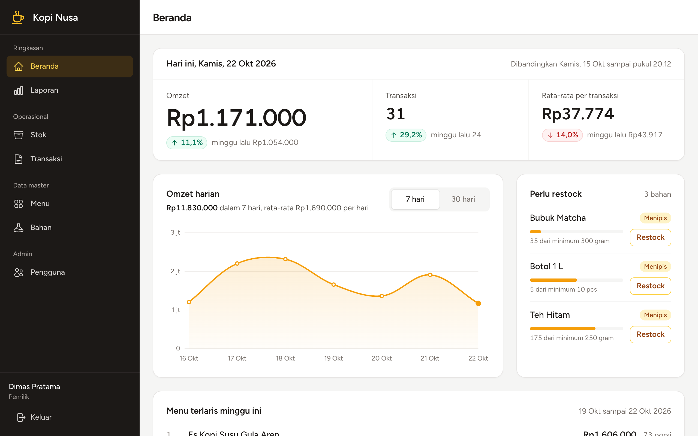

**Video demo (±1,5 menit):** [Tonton di YouTube](https://youtu.be/GANTI-DENGAN-LINK-VIDEO) · atau putar berkas lokal [`docs/demo.mp4`](docs/demo.mp4)

> Proyek portofolio berbasis studi kasus. Cerita lengkapnya (masalah, analisis, solusi, hasil) ada di [docs/STUDI-KASUS.md](docs/STUDI-KASUS.md).

---

## Fitur utama

### Kasir
- **POS untuk tablet**: grid menu per kategori dengan pencarian, tombol besar, total selalu terlihat. Di ponsel ada bar total yang menempel di bawah.
- **Stok terlihat sebelum bayar**: tile menu menunjukkan sisa porsi bila tinggal sedikit dan "Habis" bila bahan tidak cukup. Jika stok berubah di tengah transaksi, baris keranjang yang terdampak ditandai dengan tombol "Kurangi ke N" atau "Hapus".
- **Jalur cepat keyboard**: `/` memfokuskan pencarian, Enter menambahkan menu teratas, jumlah bisa diketik langsung, dan struk ditutup dengan Esc.
- **Keranjang**: tambah/kurang jumlah, catatan per item (mis. "less sugar") yang dibuka hanya bila perlu. Keluar dari kasir saat masih ada pesanan meminta konfirmasi.
- **Pembayaran** tunai, QRIS, atau transfer. Untuk tunai, tombol nominal cepat (uang pas, lalu pecahan di atas total) dan kembalian dihitung otomatis.
- **Struk** siap cetak dengan nomor invoice `INV-YYYYMMDD-0001`; kembalian tampil besar di atasnya.
- **Riwayat hari ini** milik kasir sendiri, dengan cetak ulang struk.

### Pemilik (owner)
- **Beranda (dashboard)**: omzet, jumlah transaksi, dan rata-rata hari ini dibandingkan hari yang sama minggu lalu sampai jam yang sama; daftar bahan yang perlu restock; grafik omzet 7/30 hari; 5 menu terlaris minggu ini.
- **Master data**: kategori, menu (foto opsional), bahan, dan resep per menu yang disimpan sekaligus. Menu aktif tanpa resep diingatkan di daftar menu.
- **Stok**: diurutkan dari yang paling perlu dibeli. Restock cukup diisi jumlah dan total harga nota; harga per satuan dan rata-rata tertimbang dihitung otomatis. Ada juga stock opname (penyesuaian ke hasil hitung fisik), pencatatan bahan terbuang, dan riwayat pergerakan stok per bahan.
- **Transaksi dan void**: daftar semua transaksi dengan filter dan total omzet untuk filter itu, void dengan alasan; stok dikembalikan otomatis dan transaksi tidak dihapus.
- **Laporan** untuk rentang tanggal: rekap per metode bayar, laba kotor dan margin dari HPP historis, nilai bahan terbuang, transaksi per jam, menu terlaris, dan **ekspor Excel** (4 sheet, angka berformat Rupiah, total berupa rumus).
- **Pengguna**: tambah, ubah peran, nonaktifkan/aktifkan, reset kata sandi. Pengguna tidak pernah dihapus.

## Stack

| Bagian | Teknologi |
|---|---|
| Backend | Laravel 13, PHP 8.3+ |
| Database | MySQL 8+ (sesi dikunci ke zona waktu WIB) |
| Antarmuka | Blade, Livewire 4 (POS), Alpine.js, Tailwind CSS 3 |
| Grafik | Chart.js 4 |
| Ekspor | maatwebsite/excel 4 (PhpSpreadsheet) |
| Autentikasi | Laravel Breeze (Blade) |
| Tes | Pest 5, termasuk tes konkurensi multi-proses |
| Dokumentasi | Playwright + ffmpeg (hanya untuk screenshot dan video, terpisah dari aplikasi) |

## Alur proses

**Sebelum (as-is)**

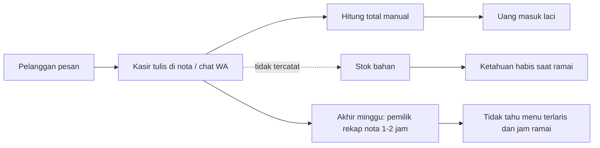

**Sesudah (to-be)**

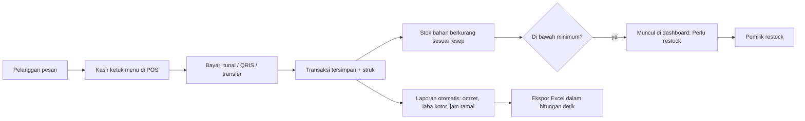

## ERD

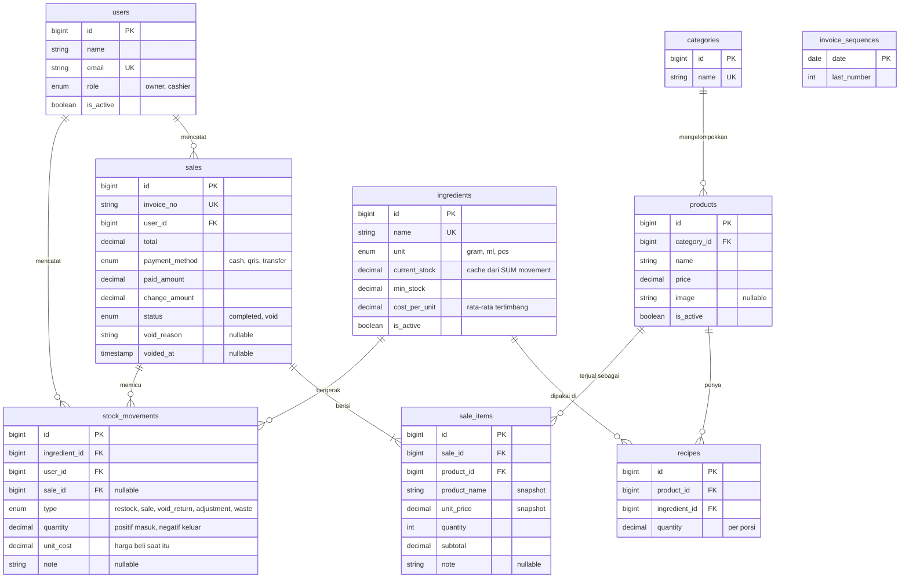

## Aturan bisnis dan keputusan teknis

- **Checkout dalam satu transaksi database.** Simpan transaksi, item, dan pengurangan stok dalam satu `DB::transaction`. Jika stok satu bahan saja kurang, transaksi ditolak dengan pesan bahan apa yang kurang dan berapa ("Stok tidak cukup: Susu UHT kurang 100 ml"), dan tidak ada data yang tersimpan.
- **Penguncian stok saat checkout.** Baris bahan yang dipakai dikunci (`SELECT ... FOR UPDATE`) **selalu dalam urutan id yang sama**, sehingga dua kasir yang menjual bahan yang sama bergantian dengan rapi dan tidak saling deadlock. Kasir kedua melihat stok yang sudah berkurang.
- **Nomor invoice bebas bentrok.** Penghitung per hari di tabel `invoice_sequences`. Baris hari itu dibuat sebelum transaksi dimulai; di dalam transaksi penghitung dinaikkan dengan satu `UPDATE` yang langsung mengunci baris sampai commit. Checkout yang gagal ikut me-rollback penghitungnya, jadi nomor tidak bolong. Ditambah unique index sebagai pengaman terakhir.
- **HPP historis.** Setiap movement menyimpan `unit_cost`, yaitu harga beli per satuan saat itu. HPP laporan = Σ jumlah × `unit_cost` dari movement penjualan, bukan harga beli hari ini, sehingga laba kotor bulan lalu tidak berubah ketika harga kopi naik. Restock memperbarui `cost_per_unit` dengan rata-rata tertimbang.
- **Snapshot harga.** `sale_items` menyimpan nama dan harga saat transaksi; perubahan harga menu tidak mengubah transaksi lama.
- **Void yang tidak bisa diulang.** Baris `sales` dikunci dulu; void kedua (termasuk yang datang bersamaan) melihat status void dan ditolak. Stok dikembalikan **persis sebesar movement penjualan aslinya**, bukan dihitung ulang dari resep yang mungkin sudah berubah, sebagai movement `void_return` dengan `unit_cost` aslinya.
- **`php artisan stock:verify`.** `stock_movements` adalah sumber kebenaran; `ingredients.current_stock` hanya cache yang diubah lewat `StockService`. Perintah ini membandingkan keduanya per bahan dan keluar dengan kode 1 jika ada selisih.
- **Selalu ada owner aktif.** Owner tidak bisa menonaktifkan atau menurunkan peran dirinya sendiri, dan baris owner dikunci saat pengecekan sehingga dua owner yang saling menurunkan peran bersamaan tetap menyisakan satu owner aktif.
- **Laporan di database, zona waktu Jakarta.** Semua agregasi memakai SUM/COUNT/GROUP BY di MySQL, transaksi void tidak dihitung, dan sesi database dikunci ke `+07:00` agar transaksi pukul 23.50 tidak tergeser ke hari berikutnya.
- **Logika bisnis di service.** `SaleService`, `StockService`, `ReportService`, `UserService`; controller dan komponen Livewire hanya memanggilnya.

## Tantangan dan pembelajaran

**Tes yang tampak lulus belum tentu membuktikan apa-apa.** Tes penguncian pertama memakai dua koneksi database di dalam satu proses tes. Ternyata baris yang di-insert dalam transaksi tes yang belum di-commit sudah terkunci secara implisit oleh InnoDB, jadi tes itu akan tetap lulus walaupun kodenya tidak mengunci apa pun. Tes konkurensi kemudian dipindah ke proses PHP sungguhan: tes membuat beberapa proses anak dengan `pcntl_fork`, masing-masing dengan koneksi MySQL sendiri pada data yang sudah di-commit. Proses induk memegang kunci lebih dulu supaya semua anak dipastikan berada di dalam operasi yang sama pada saat bersamaan, lalu melepasnya.

**Deadlock nomor invoice.** Versi pertama penomoran membuat baris penghitung dengan `INSERT IGNORE` lalu membacanya dengan `SELECT ... FOR UPDATE`. Saat lima checkout berjalan bersamaan, sebagian gagal dengan error MySQL 1213 (deadlock). Penyebabnya: `INSERT IGNORE` pada baris yang sudah ada mengambil *shared lock*; semua transaksi memegang shared lock lalu masing-masing mencoba menaikkannya menjadi *exclusive lock* dan saling menunggu. Perbaikan: penghitung dinaikkan dengan satu `UPDATE` yang langsung mengambil exclusive lock. Tes paralel berikutnya menemukan varian kedua: pada transaksi pertama hari itu, beberapa proses yang membuat baris penghitung baru bersamaan juga bisa deadlock. Baris hari itu kini dibuat **sebelum** transaksi checkout, dalam perintah singkat terpisah yang di-retry jika perlu.

**Void ganda.** Empat proses mencoba void transaksi yang sama sekaligus. Dengan baris `sales` terkunci, tepat satu berhasil dan tiga ditolak dengan pesan "sudah di-void"; stok kembali sekali.

**Uji mutasi untuk membuktikan tesnya.** Setiap tes konkurensi diperiksa dengan sengaja menghapus kuncinya: tanpa kunci bahan, enam checkout untuk stok yang hanya cukup empat semuanya lolos dan stok menjadi negatif; tanpa kunci `sales`, keempat void berhasil dan stok dikembalikan empat kali; tanpa kunci owner, dua owner saling menurunkan peran dan tidak ada owner tersisa. Ketiga tes langsung gagal, lalu kunci dipasang kembali.

**N+1 dan route yang terlewat.** `Model::preventLazyLoading()` aktif di luar produksi sehingga query N+1 langsung menjadi exception saat tes. Satu tes mengiterasi seluruh route terdaftar: route owner harus menolak kasir (403) dan tamu, route kasir harus menolak owner, dan route baru yang belum diklasifikasikan membuat tes gagal.

## Galeri

| | |
|---|---|
| 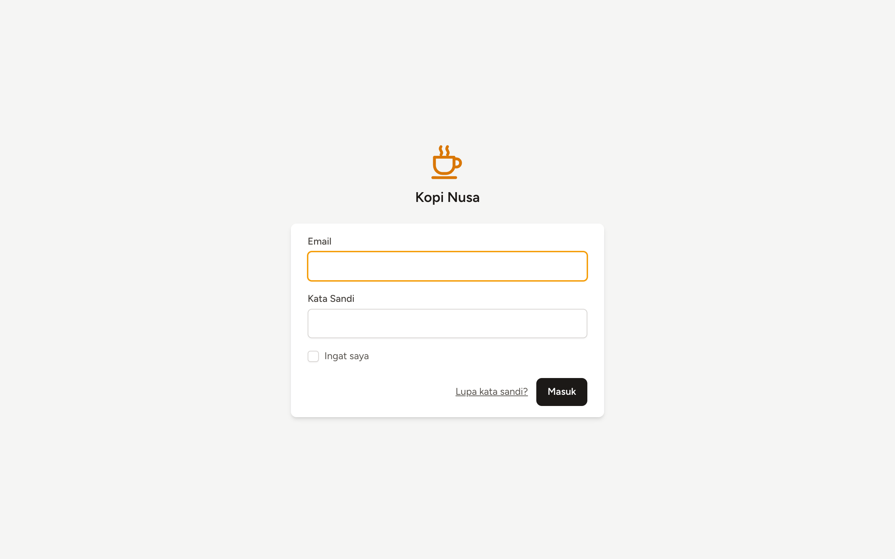 Login | 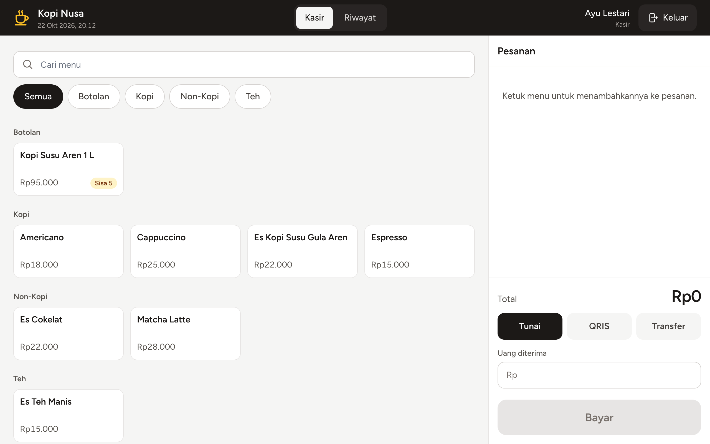 POS di laptop |
| 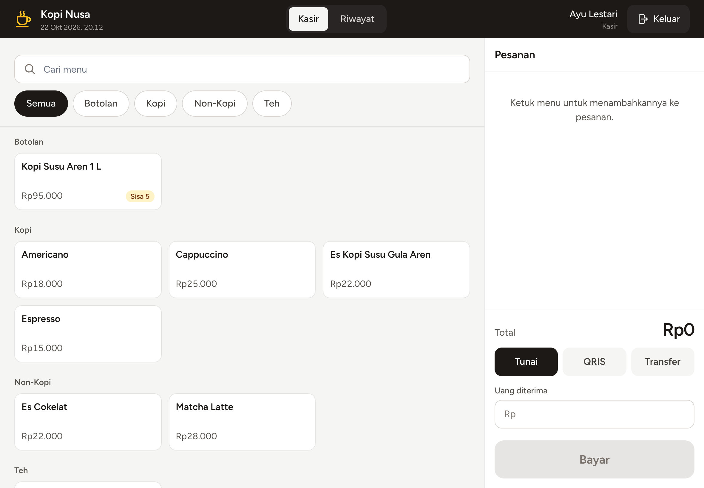 POS di tablet | 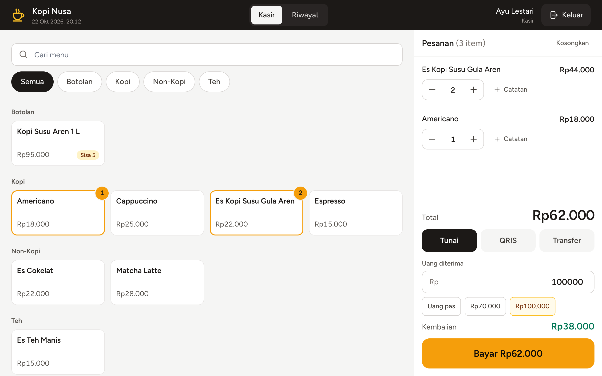 Keranjang dan pembayaran tunai |
| 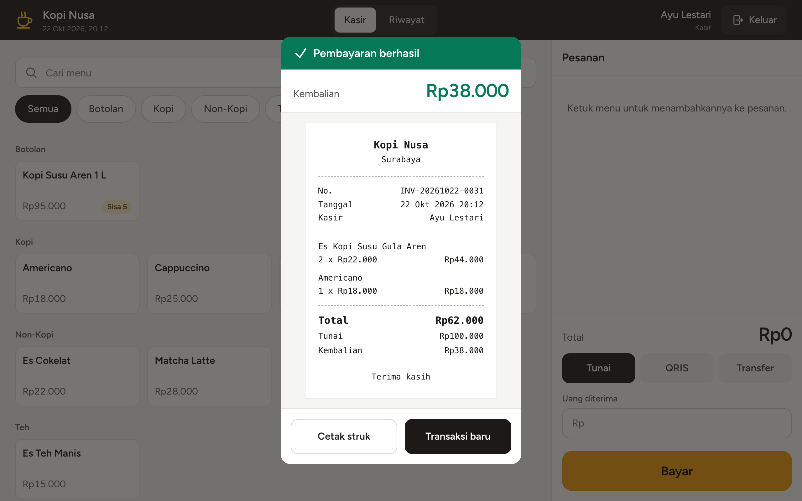 Struk setelah bayar | 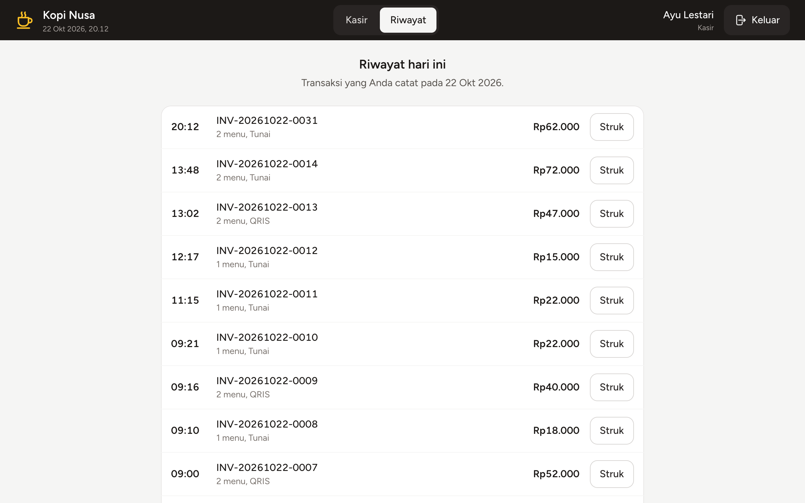 Riwayat kasir hari ini |
| 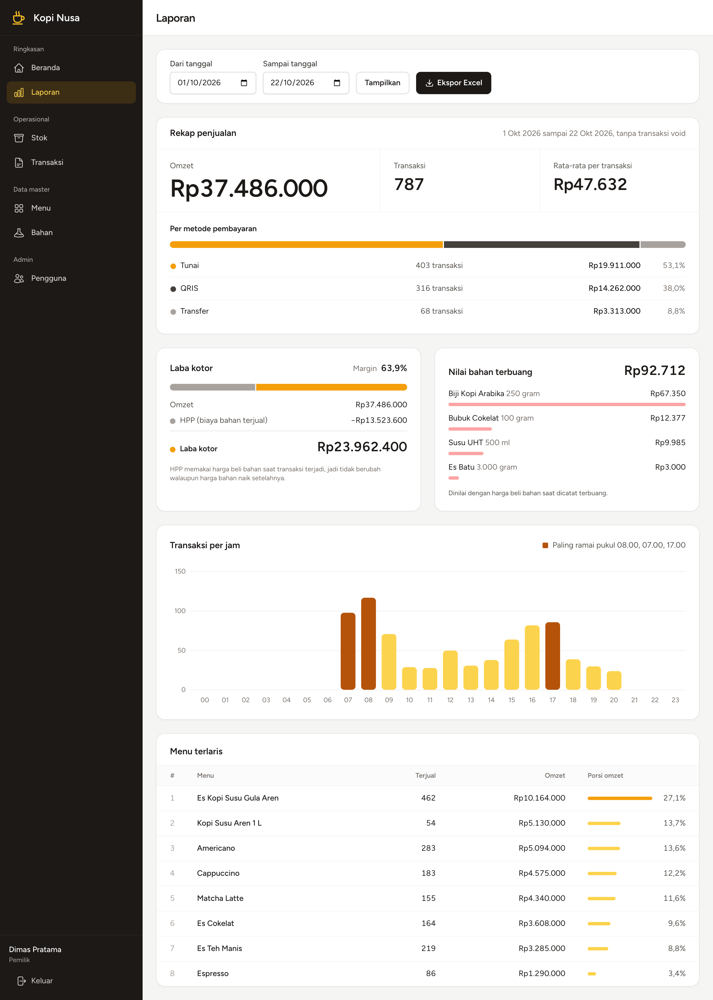 Laporan | 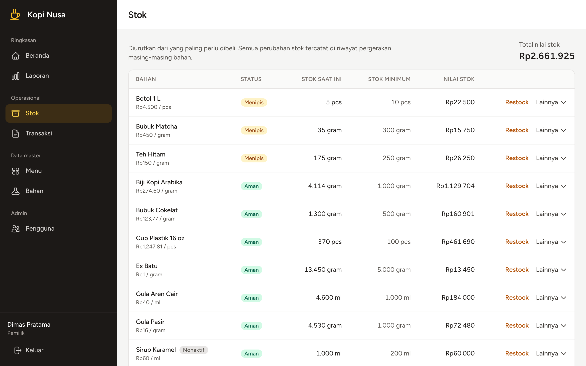 Stok bahan |
| 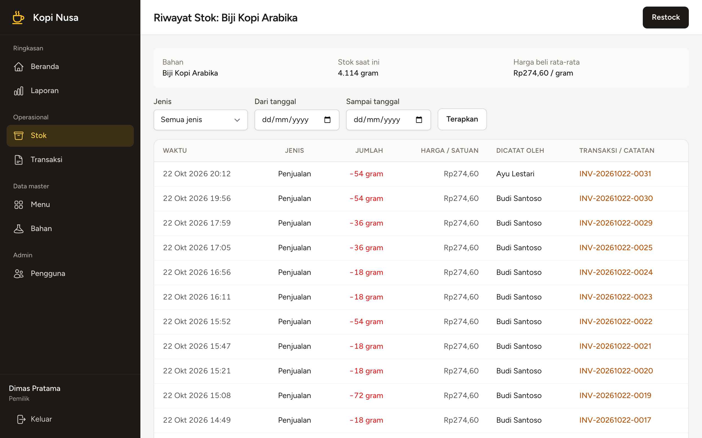 Riwayat pergerakan stok | 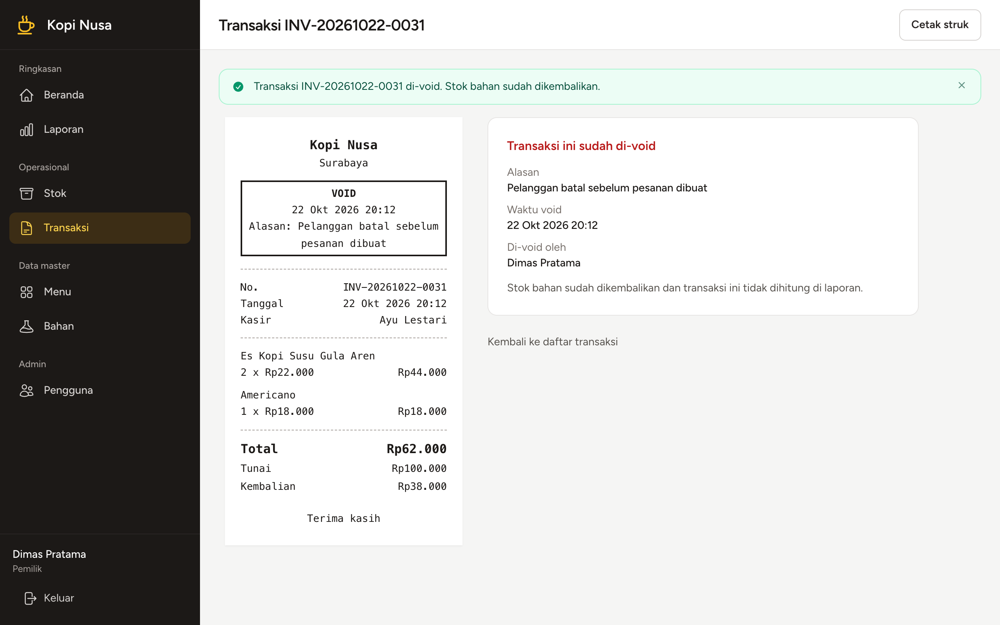 Detail transaksi void |
| 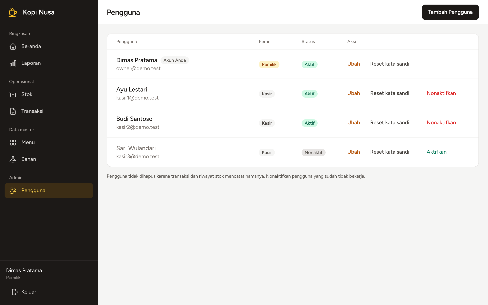 Manajemen pengguna | 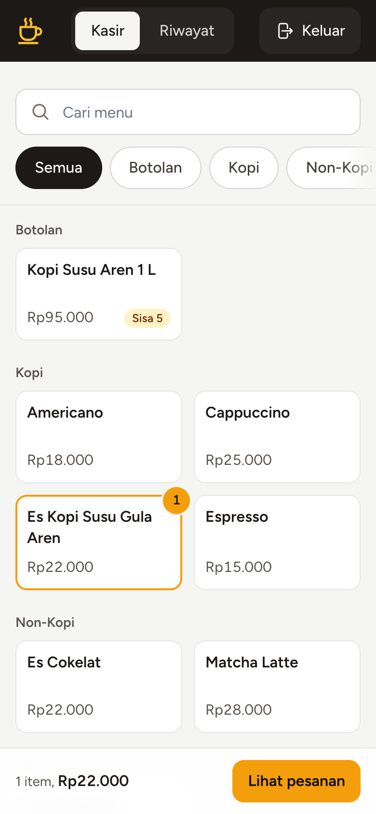 POS di ponsel |
| 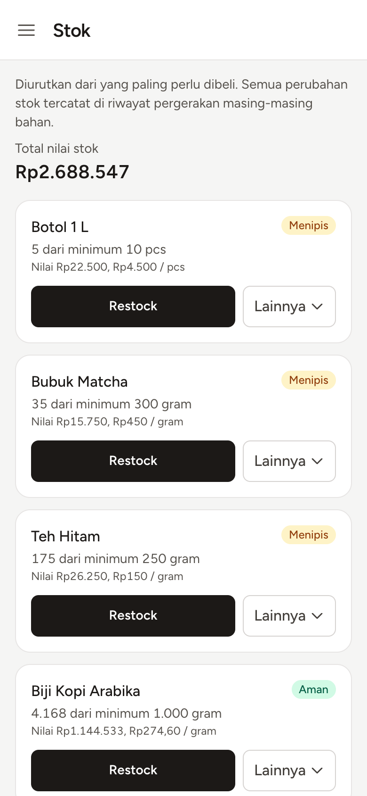 Stok di ponsel | |

## Menjalankan secara lokal

**Prasyarat:** PHP 8.3+ dengan ekstensi `bcmath` dan `pdo_mysql` (ditambah `pcntl` dan `posix` untuk tes konkurensi), Composer, Node.js 20+, MySQL 8+.

```bash
git clone <url-repo> kopi-nusa && cd kopi-nusa
composer install
npm install

cp .env.example .env          # sesuaikan DB_USERNAME / DB_PASSWORD bila perlu
php artisan key:generate

# Database aplikasi dan database khusus tes
mysql -u root -e "CREATE DATABASE kopi_nusa CHARACTER SET utf8mb4 COLLATE utf8mb4_unicode_ci;
                  CREATE DATABASE kopi_nusa_test CHARACTER SET utf8mb4 COLLATE utf8mb4_unicode_ci;"

php artisan migrate:fresh --seed   # akun demo + data 30 hari yang berakhir hari ini
php artisan storage:link           # untuk foto menu
npm run build
php artisan serve                  # buka http://127.0.0.1:8000
```

### Akun demo

Semua kata sandi: `password`.

| Peran | Email | Catatan |
|---|---|---|
| Pemilik | `owner@demo.test` | Beranda, stok, laporan, pengguna |
| Kasir | `kasir1@demo.test` | Ayu Lestari |
| Kasir | `kasir2@demo.test` | Budi Santoso |
| Kasir nonaktif | `kasir3@demo.test` | Tidak bisa login (demo manajemen pengguna) |

### Tes dan pemeriksaan

```bash
php artisan test          # Pest: fitur, laporan, keamanan route, dan tes konkurensi multi-proses
vendor/bin/pint --test    # gaya kode
php artisan stock:verify  # current_stock harus sama dengan total pergerakan stok
```

Tes memakai database `kopi_nusa_test` (lihat `phpunit.xml`) dan menolak berjalan di database yang namanya tidak berakhiran `_test`, jadi data lokal Anda tidak akan terhapus. Tes konkurensi otomatis dilewati bila `pcntl`/`posix` tidak tersedia.

### Membuat ulang screenshot dan video

Alat dokumentasi ada di `scripts/demo-video/` dengan dependensinya sendiri, sehingga tidak ikut `npm install` aplikasi. Membutuhkan Google Chrome terpasang (atau set `DOCS_BROWSER=chromium` setelah `npx playwright install chromium`).

```bash
npm run docs:install       # sekali saja: Playwright, ffmpeg untuk perekam, ffmpeg-static untuk MP4
npm run docs:screenshots   # docs/screenshots/*.png
npm run docs:video         # docs/demo.mp4 (1280x800)
```

Kedua perintah **mereset database lokal `kopi_nusa`** dengan `migrate:fresh --seed` agar hasilnya konsisten, lalu menjalankan aplikasi sendiri di port 8123 selama perekaman.
